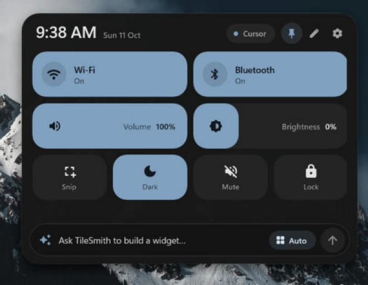

<p align="center"></p>

<h1 align="center">TileSmith</h1>

<p align="center"><b>Quick settings for Windows that your AI builds for you.</b><br>
A Liquid Glass panel in the taskbar corner, and Widget Studio, where you describe a widget, watch it appear
with your real data in seconds, and keep chatting (or tweak it yourself) until it's exactly right.</p>

<p align="center"></p>

## Install

1. Download **`TileSmith-win-Setup.exe`** from the [latest release](https://github.com/T3lluz/TileSmith/releases/latest).
2. Run it. TileSmith installs for your user (no admin needed) and appears next to the clock.
   Windows SmartScreen may warn because the app isn't code-signed yet — choose *More info › Run anyway*.
3. Click the icon (or press **Win + Shift + Q**) to open the panel.

TileSmith keeps itself up to date: when a new version is out you'll see it in the panel, the tray icon's
dot turns green, and one click installs it.

## Use it

- **Click** switches to flip them, **drag** sliders, pick options in segmented bars; buttons do what they say.
- **Press and hold** a tile to lift it, then drag it where you want it; hold without moving for its menu
  (size, duplicate, edit JSON, take off the panel). In edit mode (pencil) the **corner handle** resizes and **✦** opens it in Widget Studio.
- **+ Add widget** opens the gallery: ready-made widgets drawn as they'll look (Quick Settings, shortcuts, PC
  dashboards, weather, now playing, headlines, your server). One click adds one; the pencil opens it in the Studio first.
- Shortcuts: Ctrl+K ask the AI · Ctrl+G gallery · Ctrl+E edit · Ctrl+M model · Ctrl+, settings · ↑ previous prompts.
- **Ask for anything** in the bar at the bottom: it opens **Widget Studio**. Try:
  - *“Weather where I live with the next few days”* · *“CPU and memory as rings with a CPU graph”*
  - *“Switch my laptop display between 2560×1440 and 1920×1200”* · *“A switch for my VPN”*
  - *“What's playing, with the cover art”* · *“The five apps using the most CPU”* · *“A countdown to my vacation”*

## Widget Studio

The conversation is on the left; on the right your widget sits on a stage at its real size with its real data (and it
works: switches switch). One message, one design: the AI answers in seconds with a widget that always draws, a short
reply and a few one-click suggestions for what to change next.

- **Keep chatting**: “make it more compact”, “add a graph”, “use the ocean palette”. The AI changes only what you ask.
- **Blocks**: click a block (in the list or on the stage) to change what it shows, how it shows it, its label, colour,
  container and width, or move and remove it. **Look**: size, palette, background, shapes and refresh, no AI needed.
  **JSON**: the design itself.
- **Undo** steps back through the last twenty changes. Every change saves as you go; **Add to panel** puts it on the
  panel, and from then on the panel follows your changes live.
- What a widget still needs (your town for the weather, your OK for a script or a site, a server) shows as chips under
  the stage. Tiles that fail later offer **Fix with AI**, which hands the error back to the Studio.

Widgets are designs in the same language as DailyDash's Tilesmith: one of seven sizes (icon 1×1, mini 2×1, small 2×2,
tall 2×3, bar 4×1, wide 4×2, large 4×3), a Material 3 palette (your accent colour, or ocean, berry, forest, sunset,
lemon, lavender, mint, racing, sand, mono), a surface, and up to four rows of blocks: numbers, rings, wavy bars, charts,
lists, text, badges on the 35 M3 Expressive shapes, clocks, countdowns, buttons, AI lines, pictures, carousels, a media
player, and Quick Settings switches, sliders and choices. Each block shows one source: CPU, memory, disk, battery,
the busiest apps, Wi-Fi, Bluetooth, dark mode, volume, brightness, the power mode, resolution and refresh rate, a VPN,
an app, the network, ping, what's playing, the weather, your server, any RSS feed, JSON API or picture, kept counters,
lines and rows your AI writes, and short PowerShell queries for anything else (you approve each one once).

## Connect your AI

Open **Settings › AI** and pick a provider — each shows whether it's ready, and its live model list:

| Engine | How it connects |
|---|---|
| **OpenCode** (free models) | The official `opencode` CLI on this PC or your server — free models without an account; sign in to OpenCode Zen for more |
| **Hermes Agent** (Nous Research) | SSH to your server, runs `hermes chat --query-file …` |
| **OpenAI-compatible API** | Hermes API server, Ollama, vLLM, LM Studio, OpenRouter… — through an SSH tunnel or directly |
| **Custom command** | Any CLI on your server that reads a prompt (`claude -p`, `ollama run …`, `llm`) |
| **Claude** (your subscription) | The official Claude Code CLI on this PC — sign in with `claude auth login` |
| **Cursor** (your subscription) | The official Cursor Agent CLI on this PC — sign in with `cursor-agent login` |
| **Anthropic, OpenAI, Gemini, OpenRouter, Groq, Mistral, xAI, DeepSeek** | Your API key, stored encrypted with DPAPI |
| **Ollama, LM Studio** | Models running on this PC |

The model picker (the chip in the panel's header or the Studio) shows every model each provider offers — live
from the provider, with names, release dates, context sizes and prices from [models.dev](https://models.dev) —
and searches across all of them. If the chosen AI can't be reached, TileSmith falls back to the next ready one
(Settings › AI › Behaviour).

**Run as administrator** (Settings › General) starts TileSmith elevated — Windows asks once — so widgets and the
AI can change system settings without a prompt every time.

For a server: type `you@hostname` (or pick it from your **Tailscale** tailnet), enter the password and press
**Connect**, then **Detect** to find the AI tools there. *Sign in with a key instead* swaps the password for a
dedicated SSH key. Passwords and API keys are encrypted with Windows (DPAPI) for your account only, and
server host keys are pinned on first connect.

## How it works

Every widget is a small JSON design (kept in `%AppData%\TileSmith\designs.json`, with the panel's order): a size,
palette and surface, and rows of blocks bound to sources by name. The AI is handed the whole design language and every
source, answers with one JSON object, and TileSmith reads it leniently, clamps it to its size and sends it back once
with what was wrong if it used a source that doesn't exist, so a widget always draws. Sources are read at their own
pace (CPU every two seconds, the weather every ten minutes, AI lines every hour), shared between widgets and kept on
disk, so the panel opens on the last values. Switches, sliders, choices and buttons go through TileSmith's built-in
actions (display modes, brightness, volume and microphone, dark mode, power mode, Wi-Fi and Bluetooth, media keys,
apps, URLs, Windows Settings pages, shortcuts). Widgets from 0.4 are converted on first start; free-form layouts get a
one-click "Rebuild" that hands their request to the Studio.

```
src/TileSmith.Core   designs, sources, the resolver and controls, the AI designer, actions (Win32 display/audio/power…), AI backends, SSH
src/TileSmith        WinUI 3 app: tray icon, glass panel, tile renderer, gallery, Widget Studio, settings, Velopack updates
tests/               unit tests, plus opt-in runs against a real AI (TILESMITH_IT_AI) and server (TILESMITH_IT_SERVER)
```

## Build from source

Requires Windows 10 1809+ and the .NET 10 SDK.

```bash
dotnet test --project tests/TileSmith.Core.Tests
```

```bash
dotnet run --project src/TileSmith -p:Platform=x64
```

Releasing: add a section to `CHANGELOG.md`, then push a tag like `v0.2.0`. The
[Release workflow](.github/workflows/release.yml) builds, packages with Velopack and publishes the
GitHub release that installed copies update from.

## License

MIT — see [LICENSE](LICENSE) and [THIRD-PARTY-NOTICES.md](THIRD-PARTY-NOTICES.md).
